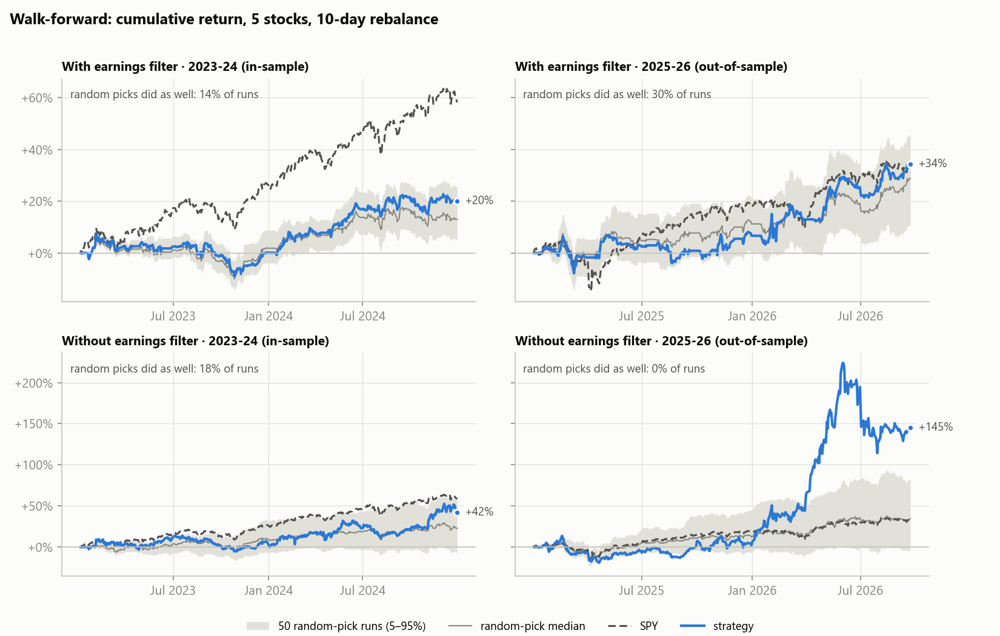
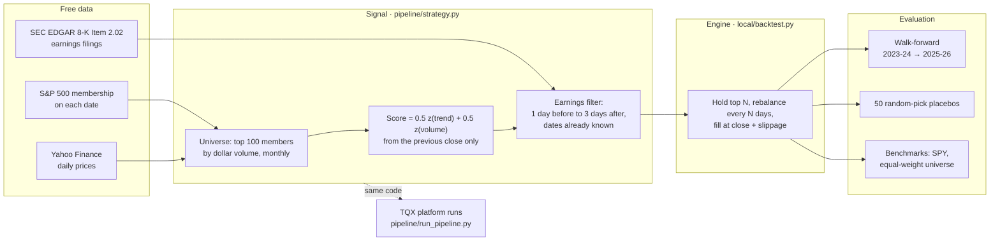
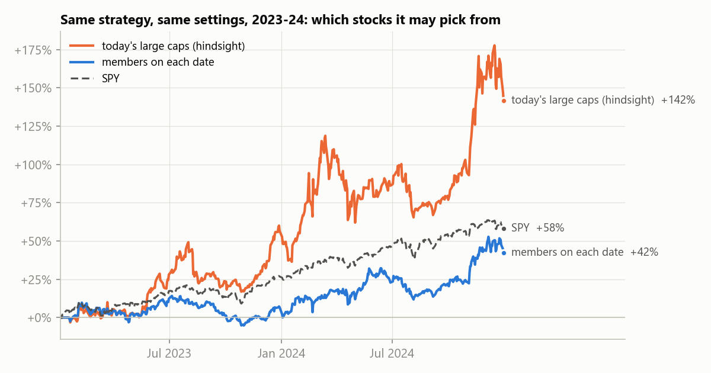
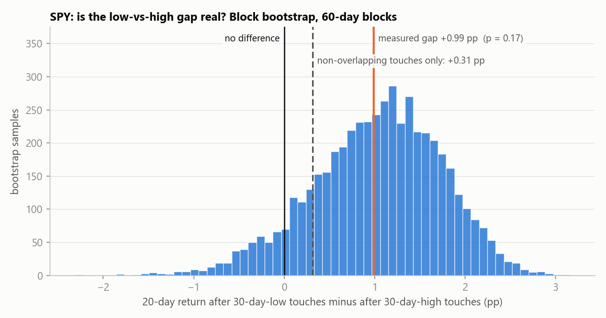
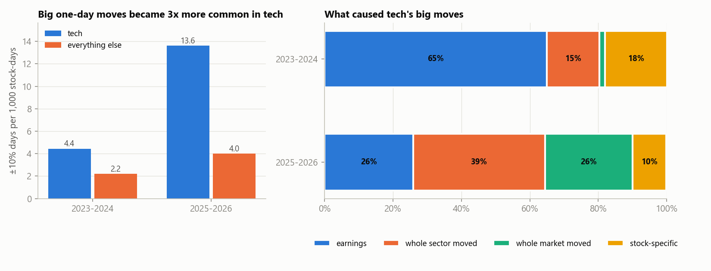

# Multi-Factor Equity Backtest

[](https://github.com/GpuCpuPsu/multifactor-backtest/actions/workflows/tests.yml)

A momentum + volume stock-ranking strategy with an earnings-catalyst filter. It started on the [TQX](https://www.tqx.ai) quant platform and was rebuilt to run locally on free data, then stress-tested for backtest biases and for whether it beats random stock selection.

**Main finding:** once hindsight bias and look-ahead bias were removed, the earnings-catalyst filter did **no better than picking stocks at random** from the same candidates. Without the filter, the momentum/volume tilt beat the market out-of-sample (2025–26), but mostly by riding one AI/semiconductor rally, so it is not yet proven.



*Blue: the strategy. Grey band: 50 runs that pick at random from the same eligible stocks. Dashed: SPY. If the blue line stays inside the band, the stock picking adds nothing.*

## How it works



The signal code is shared: the local engine imports `pipeline/strategy.py` directly, so local and TQX runs score stocks identically. The Qube version in `qube/` is tested to match it exactly.

## Bias fixes, each locked in by a test

| Bias | What went wrong | Fix | Test |
|---|---|---|---|
| **Hindsight stock selection** (survivorship) | Testing on today's large caps means only ever picking future winners | Pick only from stocks that were S&P 500 members **on that date** | [`tests/bias/test_survivorship.py`](tests/bias/test_survivorship.py) |
| **Look-ahead in the price signal** | The score used the same close the strategy then traded at | Score from the previous close | [`tests/bias/test_lookahead_signal.py`](tests/bias/test_lookahead_signal.py) |
| **Look-ahead in earnings timing** | SEC timestamps are UTC; read as Eastern time, after-close releases looked known during that day's session | Map each filing to the first session that opens after it | [`tests/bias/test_earnings_timing.py`](tests/bias/test_earnings_timing.py) |

Putting either look-ahead bug back makes its tests fail, so the protection is checked on every push. The hindsight fix alone changed the same backtest from +142% to +42%:



## Results (point-in-time S&P 500, 0.001 slippage)

| Strategy | 2023–24 (in-sample) | 2025–26 (out-of-sample) | vs. random picks |
|---|---|---|---|
| With earnings filter (5 stocks, 10-day rebalance) | +20% | +34% | no better than random (p = 0.14 / 0.30) |
| Without earnings filter | +42% | +145% | in-sample p = 0.18; out-of-sample beat all 50 on return, but 14% matched its Sharpe |
| SPY buy-and-hold | +58% | +35% | — |
| Universe equal-weight | +44% | +56% | — |

**p** is the share of the 50 random-pick runs that did at least as well as the strategy. All figures, tables and charts come from the same run (`python local/make_charts.py --refresh`); rerunning later can shift them slightly as Yahoo revises its price history.

## Side studies

**SPY at its 30-day high or low.** Touches of the 30-day low were followed by better 20-day returns than touches of the 30-day high (+0.99 percentage points). Touches overlap heavily, though: once that is accounted for with a block bootstrap, or by keeping only non-overlapping touches, the gap is **not significant**.



**±10% one-day moves.** In 2025–26 these became 3× more common in tech, and most were whole-sector or whole-market moves driven by news (AI announcements, policy), not stock-specific ones. A model trained on 2023–24 predicted *which* stocks would move big in 2025–26 well (AUC 0.90, mostly from earnings timing and recent volatility), but not *which direction* (AUC 0.53, close to a coin flip).



## Tests

```bash
pytest          # 45 tests, offline, about 2 seconds
```

| Folder | Covers |
|---|---|
| `tests/bias/` | look-ahead in signals, survivorship, earnings timestamp mapping |
| `tests/strategy/` | engine: fills and slippage, position sizing, delistings, placebo, benchmark |
| `tests/spy/` | 30-day level rules (bounce / break / failed break) and the significance test |
| `tests/tech/` | big-mover features use only the prior close; cause attribution |

## Repository layout

| Path | What it is |
|---|---|
| `pipeline/strategy.py` | The strategy, in TQX's backtest format |
| `pipeline/run_pipeline.py` | TQX orchestrator: rewrites config, creates and runs the strategy, scores results, parameter sweeps |
| `local/backtest.py` | Local backtester: point-in-time universe, walk-forward sweeps, placebo tests |
| `local/data.py` | Yahoo Finance loader with disk cache and ticker-rename handling |
| `local/edgar_events.py` | Earnings dates from SEC EDGAR 8-K filings |
| `local/spy_levels.py`, `local/spy_levels_stats.py` | SPY 30-day high/low study and its significance test |
| `local/big_movers.py` | ±10% one-day move study |
| `local/make_charts.py` | Builds the charts in `docs/img/` |
| `qube/` | The composite score as a TQX Qube factor, plus the platform workflow |
| `strategies/` | Earlier TQX experiments (runs 1–10, benchmarks, probes) |

## Setup and running

```bash
python -m venv .venv
.venv/Scripts/python -m pip install -r requirements.txt   # Windows; .venv/bin/python on macOS/Linux

# walk-forward with point-in-time membership, SEC earnings dates and 50 placebos per setting
python local/backtest.py --start 20230101 --end 20241231 --grid "3:5:off,5:5:off,3:10:off,5:10:off" \
    --universe local/ref/sp500_components_by_date.csv --events local/ref/events_sec_8k_202.csv \
    --placebo 50 --label IS --out local/results/sweep.jsonl

# refresh SEC earnings dates (SEC requires a contact in the User-Agent)
SEC_USER_AGENT="Your Name you@example.com" python local/edgar_events.py

# rebuild the charts
python local/make_charts.py --refresh
```

Price data downloads on the first run and is cached in `local/cache/`. `--grid` entries are `top_n:rebalance_days:stop(on|off)`.

## Limitations

- About 4% of past S&P 500 members have no Yahoo price data (mostly acquisitions, plus the 2023 bank failures), so a little survivorship bias remains.
- Costs are modelled as slippage only. Prices are split/dividend adjusted.
- Results cover 2023–2026 only. This is research, not investment advice.

## Data credits

- S&P 500 historical membership: [fja05680/sp500](https://github.com/fja05680/sp500), MIT License (see `local/ref/LICENSE-sp500-data.txt`)
- Earnings filings: [SEC EDGAR](https://www.sec.gov/edgar) (public data)
- Prices: Yahoo Finance via [yfinance](https://github.com/ranaroussi/yfinance) (not redistributed; downloaded at run time)
